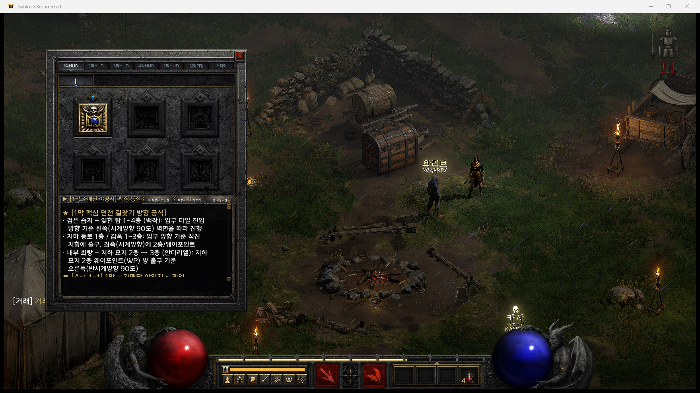
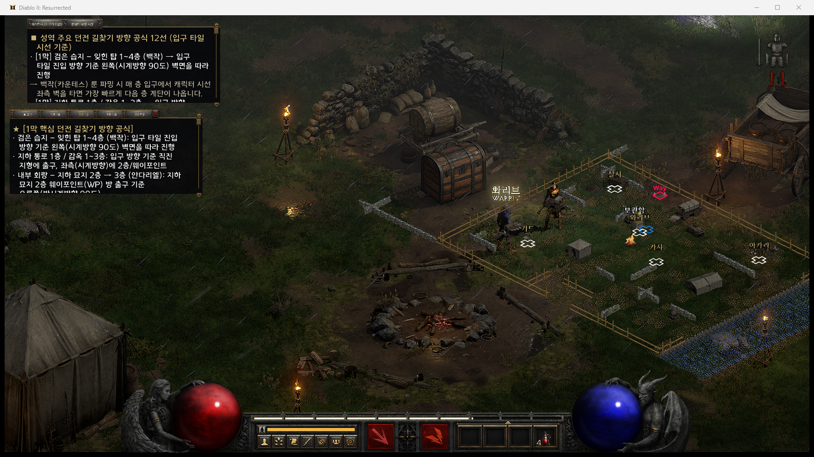
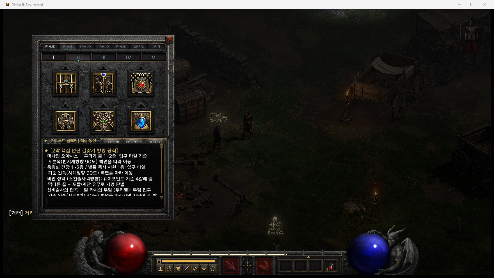
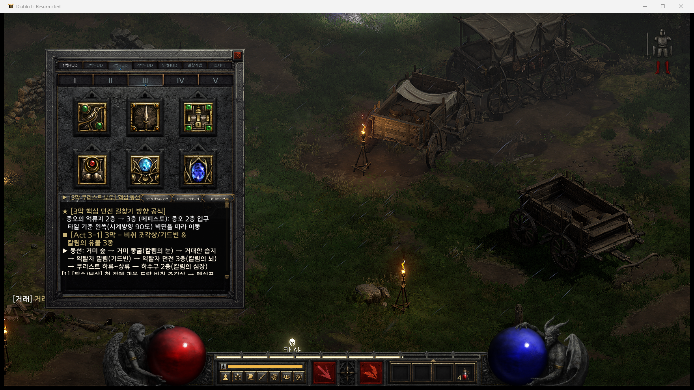

# 디아2-인게임-내비게이터 (D2R-HUD v1.4)

외부 오버레이 프로그램 없이 **디아블로 II: 레저렉션(`D2R.exe`) 게임 클라이언트 자체 UI 엔진(`data/global/ui/layouts/*hd.json`)에서 직접 구동되는 순정 인게임 내비게이터 & 호라드림 대사전 모드**입니다.

---

## 1. 실제 인게임 구동 화면 (`1막 자매단 야영지`)

| 원본 퀘스트 기록(`Q`) — 1~5막 동선·길찾기 연동 | `Tab` 미니맵 + 좌측 상단/중단 투명 HUD 수직 정렬 |
| :---: | :---: |
|  |  |
|  |  |

---

## 2. 핵심 기능 (v1.4 최신 반영)

1. **원본 퀘스트 기록(`Q`) 완벽 통합 (`questlogpanelexpansionhd.json` / `D2RHudQLAct1~5hd.json`)**
   - 퀘스트 창(`Q`) 상단 확장 탭(`1막HUD` ~ `5막HUD`, `길찾기맵`, `스타터`) 및 로마자 탭(`I` ~ `V`) 클릭 시 **해당 막의 필수 보상 퀘스트·핵심 동선·던전 길찾기 방향 공식**을 하단 스크롤 창에 즉시 출력합니다.
   - 우측 상단 버튼으로 **투명 HUD 전환**, **투명 HUD 켜기/끄기**, **룬·큐빙 사전 열기**를 바로 제어합니다.

2. **좌측 정렬 `Tab` 지도 HUD & 크기 조절형 퀘스트 HUD (`automaphd.json` / `D2RHudTrackerPanelhd.json`)**
   - **`Tab` 미니맵 연동 HUD (`x: 24, y: 18`)**: `Tab` 키로 미니맵을 켜면 우측 미니맵을 가리지 않고 **화면 좌측 상단**에 12대 핵심 던전 길찾기 방향 공식이 함께 표시됩니다.
   - **크기 조절형 투명 퀘스트 HUD (`x: 24, y: 468`)**: 좌측 중단에 수직 정렬되며 `▲ 접기` / `소형 4줄` / `중형 7줄` / `대형 12줄` / `완전투명·가독배경`을 실시간으로 전환할 수 있습니다.

3. **투명 호라드림 룬워드·큐빙 대사전 (`D2RHudMainPanelhd.json`)**
   - `캠페인 1~3막`, `캠페인 4~5막·길찾기`, `초반육성·스타터`, `룬워드 2~3홈`, `룬워드 4홈`, `룬워드 5~6홈·신규(악마술사 포함 98종)`, `호라드림 큐빙 60종`을 소형/중형/대형 크기로 조회하며 마우스오버 툴팁으로 완성 옵션을 확인합니다.

4. **디아블로 II: 레저렉션 원본 색상 토큰 100% 통일**
   - 탭(`$TabsActiveTextColorInGame`/`$TabsInactiveTextColor`), 버튼(`$LightButtonTextColor`/`$FontColorGoldYellow`), 본문(`$FontColorGoldYellow`/`$FontColorLightGold`/`$DescriptionTextColor`/`$PanelNoteTextColor`), 툴팁(`ÿc4`/`ÿc0`) 모두 레저렉션 순정 UI 컬러 팔레트와 1:1로 통일했습니다.

---

## 3. 빌드 및 MPQ 설치 방법

```bash
npm run mod:build
npm run mod:install
```

- `D:\Diablo II Resurrected\mods\yupgoolg\yupgoolg.mpq` 내부에 72개 네이티브 UI 레이아웃 JSON 파일이 자동 패킹·검증됩니다.
- 게임 실행 인자: `-mod yupgoolg -txt`

---

## 4. GitHub 원클릭 저장/가져오기 & AI 에이전트 빠른 접근

### A. 내 GitHub 저장소 원클릭 동기화 (`github-sync.bat` 또는 `npm run`)
- **원클릭 저장 (AI 번들 자동 갱신 + Commit + Push + 원격 검증)**:
  ```bash
  github-sync.bat save "수정 내역 메시지"
  # 또는: npm run github:save
  ```
- **최신 소스 가져오기 (Pull)**:
  ```bash
  github-sync.bat pull
  # 또는: npm run github:pull
  ```
- **저장소 동기화 상태 확인 및 내 전체 GitHub 저장소 목록 조회**:
  ```bash
  github-sync.bat status
  github-sync.bat repos
  ```

### B. 외부 AI (ChatGPT / Claude / Gemini / Cursor 등) 단일 URL 소스 접근
다른 AI나 에이전트에게 아래 URL 하나만 전달하면 저장소를 클론하지 않고도 프로젝트 구조와 전체 핵심 소스를 즉시 읽어 작업할 수 있습니다.
- **요약 및 Raw URL 맵 (`llms.txt`)**: `https://raw.githubusercontent.com/icandoit122118-del/D2R-HUD/main/llms.txt`
- **전체 핵심 소스 통합 번들 (`llms-full.txt`)**: `https://raw.githubusercontent.com/icandoit122118-del/D2R-HUD/main/llms-full.txt`
- **머신 리더블 JSON 매니페스트 (`ai-repo-index.json`)**: `https://raw.githubusercontent.com/icandoit122118-del/D2R-HUD/main/ai-repo-index.json`
